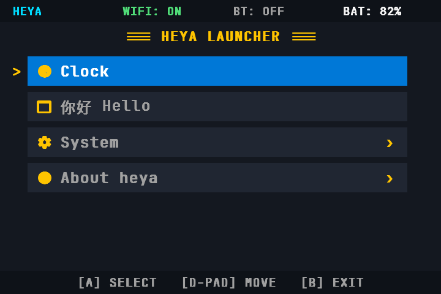
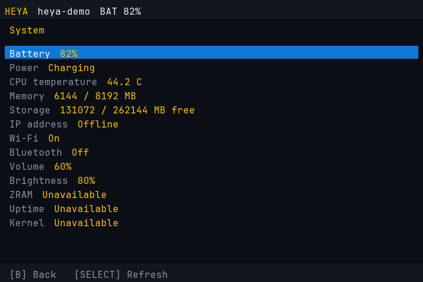
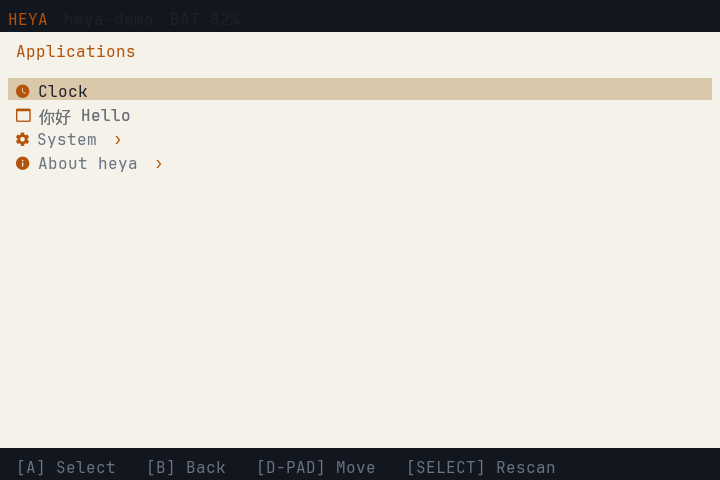
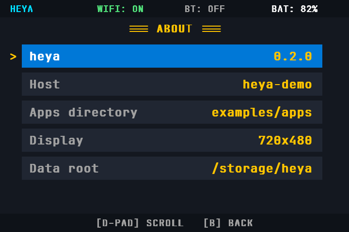
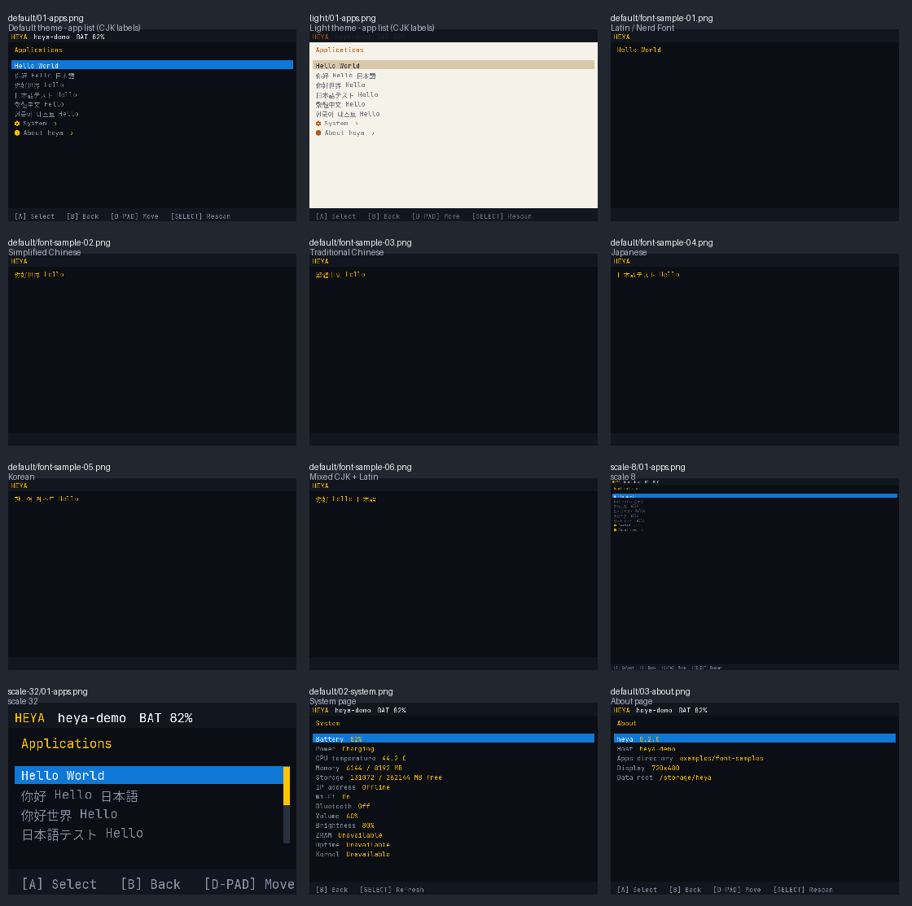
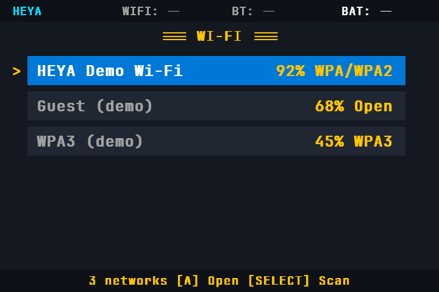
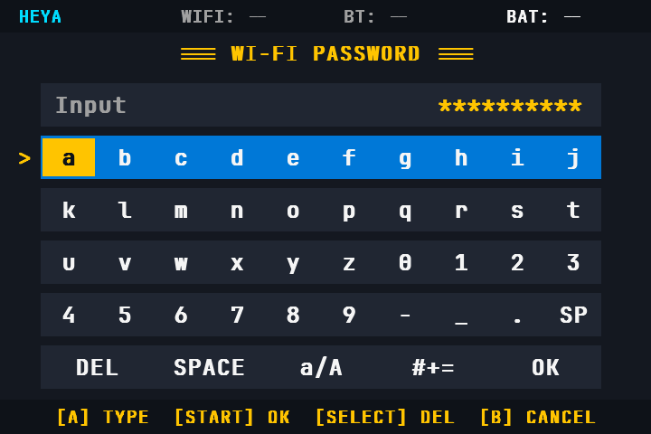
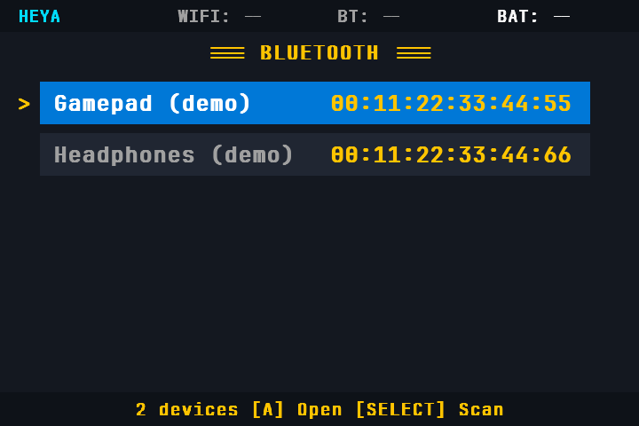
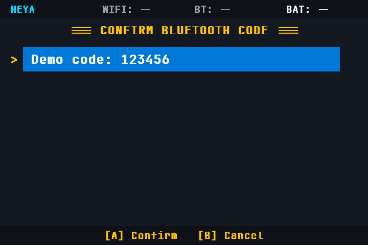

# heya

A lightweight, JSON-driven launcher shell for ARM64 Linux handhelds
(ROCKNIX, Knulli, muOS; H700-class devices such as RG34XX / RG35XX / RG40XX).

Not a game frontend: games are just one kind of application. The shape we are aiming
for is Kindle + iPod + Linux launcher + Pocket OS.

- Go + SDL2, single binary, ARM64 cross-compiled
- JSON pages, JSON themes, Nerd Font glyph icons (no PNG assets)
- CJK text alongside the icon font, with a theme-configurable fallback face
- 720x480 landscape, integer scaling
- Handheld menus with large text, blue selection panels, a four-part status bar and a fixed control footer
- Apps: drop a directory under `/storage/heya/apps` with an `app.json`; no code change

## Build and run

```sh
make build                      # ./heya (amd64)
./heya --theme themes/default/theme.json --apps examples/apps
make dump                       # render every page to build/frames/*.png (no display needed)
make test                       # unit tests
make dump-fonts                 # CJK/Latin font review shots, both themes and scales
make check-fonts                # fail if any review shot rendered no text
```

Flags: `--apps`, `--theme`, `--icons`, `--input`, `--font`, `--font-cjk`, `--scale`,
`--width`, `--height`, `--dump DIR`, `--verbose`.

On a device the binary reads `/storage/heya/apps` and seeds
`/storage/heya/themes/theme.json` on first boot.

## Layout

| Path | Purpose |
|---|---|
| `cmd/heya` | bootstrap, flags, event loop, exec, frame dump |
| `internal/input` | SDL events → semantic actions; configurable key/pad mapping |
| `internal/ui` | renderer, layout, text cache, theme colours, font fallback |
| `internal/registry` | scan `apps/*/app.json` |
| `internal/launcher` | page stack, selection, commands |
| `internal/system` | battery, temperature, memory, storage, network, volume, brightness, ZRAM |
| `assets/` | icon map + JetBrainsMono Nerd Font (OFL) |
| `themes/` | `default` and `light` theme JSON |
| `examples/apps/` | sample applications |
| `examples/font-samples/` | one app per script, for font review |
| `integrations/rocknix/` | boot unit and link to the authoritative ROCKNIX recipe |

## Documentation

- [PROJECT_PLAN.md](PROJECT_PLAN.md) — architecture, module boundaries, JSON protocol, milestones, risks
- [`docs/fonts.md`](docs/fonts.md) — Latin/CJK font fallback, theme fields, review images
- [`docs/rocknix-architecture.md`](docs/rocknix-architecture.md) — ROCKNIX boot chain, frontend entry points, game-launch contract
- [`integrations/rocknix/README.md`](integrations/rocknix/README.md) — installing heya as the boot frontend

## Screenshots

| Apps (default theme) | System | Light theme | About |
|---|---|---|---|
|  |  |  |  |

Rendered at 720x480 with the bundled Nerd Font and the handheld panel theme.
CJK labels use the fallback face. Dumps use a neutral demo
device, so no real hostname, address or memory layout is baked into the images.

Font review sheet — both themes, one specimen per script, plus scale 8 and 32:



Individual shots live in [`docs/screenshots/fonts/`](docs/screenshots/fonts/);
regenerate them with `make dump-fonts`.

## Status

Milestones M1–M5 are implemented and verified on a Linux PC (menu rendering, app
launching and return, JSON themes, app scanning, system page). M6 (replacing the
ROCKNIX frontend) ships as integration files; it needs an image build and a device
run to be accepted.

## Connectivity and device controls

In System, select Wi-Fi or Bluetooth with physical A to open its device list.
Left/right switches the selected radio off/on. Volume and brightness change in
5% steps with left/right; controls use the distro's `heya-control` helper.

Wi-Fi supports scanning, open/WPA/WPA2/WPA3 connections, saved profiles,
disconnection and forgetting a saved network. Enterprise/WEP connections require
an existing system profile. NetworkManager saves successful connection profiles.
Passwords go directly over D-Bus, never into command arguments or the journal.

Bluetooth supports scanning, pairing, numeric confirmation, PIN/passkey input,
keyboard pairing-code display, reconnect, disconnect and removal. BlueZ stores
bonds. Only the selected device can use heya's temporary pairing agent.

The onscreen keyboard uses D-pad + A. L changes case, R selects symbols,
SELECT deletes, START submits and B cancels. A physical keyboard also works.
Wi-Fi and Bluetooth credentials are shown while entering them. Scans and
connections run in the background; cancel waits for cleanup before another
radio operation starts. Settings changes finish before accepting another change.

USB settings provide MTP file transfer, USB ADB, USB networking and charge-only
modes, plus Wireless ADB controls on port 5555. MTP exposes files through the
MTP protocol; it does not expose the SD card as a raw USB disk.

Set `HEYA_SIMULATOR=1` to preview demo networks and devices without touching host
radios. Actual device pairing, saved reconnection after reboot, suspend/resume,
and audio routing still require hardware testing.

The backend follows the [NetworkManager D-Bus API](https://networkmanager.dev/docs/api/latest/gdbus-org.freedesktop.NetworkManager.html)
and [BlueZ Agent API](https://github.com/bluez/bluez/blob/master/doc/org.bluez.Agent.rst).

| Wi-Fi | Password keyboard | Bluetooth | Pairing confirmation |
|---|---|---|---|
|  |  |  |  |

Connectivity screenshots use demo devices; they do not show hardware validation.
