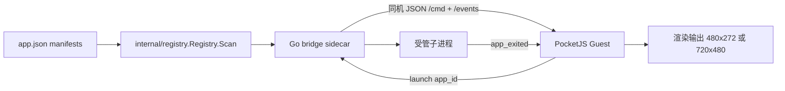
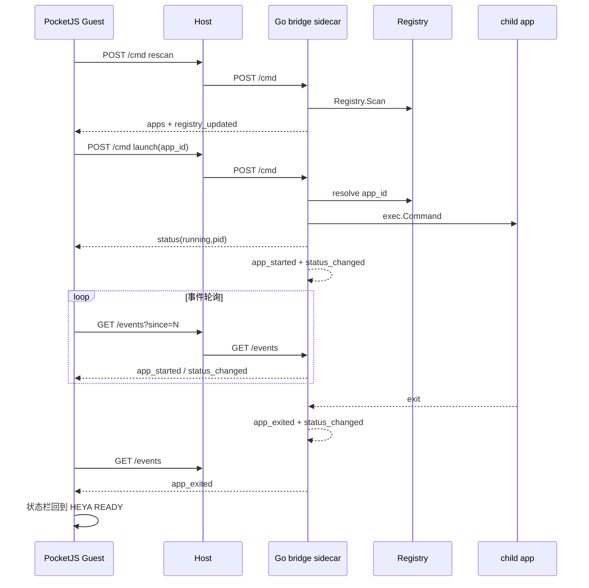

# CPR69 最终报告：PocketJS 能否替代 heya 的 SDL2 前端

分支：`pocketjs-prototype`　仓库：`<heya 工作树>`
PocketJS 版本：0.15.0　目标设备参照：RG34XX（720×480，ARM64，ROCKNIX）

---

## 一、实验环境

| 项 | 值 |
|---|---|
| 主机 | x86_64 Linux，16GiB RAM，4 核 |
| Go | go1.25.5（本机 `系统 Go`）；容器 rocknix-build 镜像 go1.23.1 |
| Rust | rustc/cargo 1.96.0；target 含 `x86_64-unknown-linux-gnu`、`aarch64-unknown-linux-gnu`、`wasm32-wasip1` |
| 显示 | X.Org 21.1.16，display `:20`（Xvfb 新建失败，复用既有） |
| GPU | **llvmpipe（LLVM 19.1.7）软件渲染**，Vulkan；无物理 GPU |
| PocketJS 检出 | `<PocketJS 检出>`（0.15.0） |
| 浏览器验证 | Playwright + Chromium 1208，headless |
| SDL2 | 2.32.4（本机 dev 库） |
| heya 源码 | 本工作树（未改动 `internal/launcher`、`internal/registry`、`internal/system`、`internal/model`、`cmd/heya`） |

---

## 二、完成内容（按阶段）

| 阶段 | 主题 | 状态 | 关键证据 |
|---|---|---|---|
| 1 | Registry → PocketJS 同步 | **已验证** | 运行时 JSON bridge；Playwright 增删应用 alpha→alpha,beta→beta，canvas 变化，无错误；截图 `registry-ui-*.png` |
| 2 | Go↔PocketJS IPC 边界 | **已验证** | sidecar `/cmd`（launch/rescan/get_status）+ `/events`；launch→app_started/app_exited→返回；截图 `bridge-launch-return.png`；`docs/pocketjs-ipc.md` |
| 3 | Linux Native Host | **已验证** | `linux-app` 编译通过；`pocket-desktop-host` 在 X11 运行输出 `READY`；xdotool 输入被接收（ctrl+q 退出）；截图 `linux-native-hero.png`、`linux-native-heya.png`（720×480） |
| 4 | 输入系统 | **部分验证** | Dpad+CROSS/CIRCLE/SQUARE/TRIANGLE 响应；长按/连按正常；**START/SELECT/L/R 无响应**（Guest 未绑定）；**菜单内焦点移动无效**；`docs/pocketjs-input.md` |
| 5 | 国际化 | **已验证** | ASCII/UTF-8/中/日/韩/Emoji/混排/繁体均渲染出字形（无 tofu）；字体加载失败为**构建期硬失败**；`docs/pocketjs-i18n.md` |
| 6 | 性能 | **已实测** | PocketJS vs SDL2 heya：RSS/CPU 对比；规模 6/50/100 卡片；`docs/pocketjs-performance.md` |
| 7 | ARM64 | **部分验证** | aarch64 交叉编译成功（ELF ARM aarch64）；QEMU 下可执行并运行到 X11 初始化；目标设备未测；`docs/pocketjs-arm64.md` |
| 8 | 最小 Launcher 闭环 | **部分验证** | 浏览器端完整闭环通过；native 端渲染/输入通过，按键注入 launch 未成功（工具时序） |
| 9 | 架构评审 | 本报告 | — |

### 阶段3 关键发现（原阻塞已解决）

heya Guest 原先依赖浏览器全局 API（`window`、`requestAnimationFrame`、`setInterval`），在 QuickJS native guest 下编译失败：
```
main.tsx:82 TS2304: Cannot find name 'requestAnimationFrame'
main.tsx:113/121 TS2304: Cannot find name 'window'
```
修复：改用 PocketJS 原生 API — `after(0, ...)`（帧计时）与 `onFrame(...)`（帧回调）。修复后 `linux-app` 编译通过，并产出 720×480 原生二进制且成功运行。

---

## 三、未完成内容 / 阻塞（诚实标注）

1. **ARM64 目标设备实测未完成**：无 RG34XX 实机；hx90（<内网 hx90 主机>）不可达（`No route to host`）。**已做到**：aarch64 交叉编译成功（ELF ARM aarch64），QEMU 下可执行（第一次运行完成参数解析与 profile 校验；第二次运行到 X11 初始化后因缺 aarch64 xlib 失败）。**未做到**：目标设备性能/内存/帧率/发热/长稳，QEMU 完整 GUI 运行（缺 aarch64 X11 sysroot）。**结论：架构支持成立，目标设备未验证**。
2. **菜单内焦点移动无效**（阶段4）：Quick Menu 打开后 ArrowDown 不改变画面。原因未定位（可能 `FocusScope` 内 focusable 收集或 scope 激活判定）。
3. **START/SELECT/L/R 未绑定**（阶段4）：Guest 未注册 `onButtonPress`。框架与 native host 均支持这些按键。
4. **native 端 launch 按键注入未成功**（阶段8）：`xdotool` 未能定位稳定窗口，属测试时序问题。
5. **性能未覆盖项**：空界面、连续滚动、GC、目标设备帧率未测；本机为 llvmpipe 软件渲染。
6. **未提供 60 分钟稳定性长跑**（阶段7 依赖 ARM64 环境）。

---

## 四、性能数据（本机 x86_64，软件渲染 llvmpipe）

### 基线（默认示例应用，3 次运行，3 秒采样）

| 指标 | PocketJS native | SDL2 heya |
|---|---|---|
| RSS 平均 | 102.4 – 102.5 MB | 125.1 – 125.6 MB |
| RSS 峰值 | ~122.9 MB | ~125.8 MB |
| CPU（3s） | 0.15 – 0.18 s | 0.28 – 0.32 s |

### 规模（6 / 50 / 100 卡片）

| 卡片数 | PocketJS RSS | PocketJS CPU | SDL2 RSS | SDL2 CPU |
|---|---|---|---|---|
| 6 | 123.4 MB | 0.04 s | 125.7 MB | 0.35 s |
| 50 | 123.3 MB | 0.03 s | 128.4 MB | 0.35 s |
| 100 | 123.3 MB | 0.03 s | 129.0 MB | 0.40 s |

**关键观察**：PocketJS RSS 不随卡片数增长（123.3–123.4 MB 恒定），空闲 CPU 约为 SDL2 的 1/10。

### 帧追踪

`--trace-frames`：稳定态 `tick` 169–474 μs（CPU 提交）；源码注明非 GPU 完成/显示延迟。首帧 `render-submit` 28 ms（初始化）。

**限制**：llvmpipe 软件渲染，绝对值不代表 RG34XX。

---

## 五、架构图

### 数据流与集成边界



### 时序（启动/退出/返回/刷新）



---

## 六、风险列表

| # | 风险 | 等级 | 说明 |
|---|---|---|---|
| 1 | **ARM64 目标设备未验证** | 高 | 交叉编译+QEMU 可执行已成立；但 RG34XX 实机性能、内存、帧率、发热、长稳均未知 |
| 2 | **dev-host 改动在仓库外** | 中 | 浏览器 `/heya/bridge/*` 代理与 `__heyaBridgeUrl` 注入是对 PocketJS 检出（外部）的本地改动，非上游 API；正式集成需独立 host 支持 |
| 3 | **sidecar 未接入 Launcher 核心** | 中 | 当前 bridge 是独立进程，调用 Registry 自管子进程；`cmd/heya` 事件循环与 `internal/launcher.Launcher` 未消费该协议 |
| 4 | **输入覆盖不全** | 中 | START/SELECT/L/R 未绑定；菜单焦点移动无效 |
| 5 | **baked 字体覆盖** | 中 | `fonts.json` `characters` 未声明码点运行时无字形；Emoji 为单色 |
| 6 | **字体缺失构建失败** | 低（正面） | fallback 缺失时构建期硬失败，利于早发现，但部署须保证字体存在 |
| 7 | **事件队列易失** | 低 | 内存事件队列上限 256，sidecar 重启归零，游标过期 410；当前状态可用 `get_status` 恢复 |
| 8 | **软件渲染测量偏差** | 中 | 全部性能数据来自 llvmpipe，不能外推目标设备 |
| 9 | **IPC 安全边界** | 中 | bridge 仅绑 loopback；若暴露需 origin/认证限制，否则任意页面可触发进程启动 |
| 10 | **Guest 额外功能（收藏）** | 低 | 超出任务书五项最小集 |

---

## 七、是否满足替换 SDL2 的条件？

**结论：Partial（部分满足）—— 架构与功能路径已验证可行，但不足以支撑"替换"。**

| 判据 | 结果 |
|---|---|
| 能渲染 heya 的应用列表 UI | ✅（480×272 浏览器；720×480 native） |
| 能接入真实 Registry 数据 | ✅（阶段1） |
| 能启动/退出/返回/刷新 | ✅（阶段2/8，浏览器端闭环） |
| 能脱离浏览器在 Linux 运行 | ✅（阶段3，native host + X11） |
| 输入覆盖满足掌机需求 | ⚠️（缺 START/SELECT/L/R；菜单焦点问题） |
| 国际化满足 | ✅（中/日/韩/Emoji 均可渲染） |
| 性能可接受 | ⚠️（本机软件渲染下优于 SDL2，但目标设备未知） |
| ARM64/目标设备验证 | ⚠️（部分：交叉编译+QEMU 可执行；设备未测） |
| 与现有 Launcher 核心集成 | ❌（sidecar 独立，未接入） |

---

## 八、最终建议

**建议：B —— 并存（继续以 SDL2 为 RG34XX 生产前端，PocketJS 作为并行技术候选继续验证）**

理由（引用实验结果）：

1. **可行性已证伪"不可行"假设**：阶段3 证明 PocketJS 0.15.0 的 `linux-app` 目标可编译、可打包、可在 Linux/X11 无浏览器运行并接收键盘输入；heya Guest 在 720×480（RG34XX 分辨率）原生渲染成功（`READY`，截图非空白）。
2. **但替换的关键前提缺失**：ARM64 目标设备完全未验证（阶段7：无实机、hx90 不可达、QEMU 缺 sysroot 无法完成 GUI 运行）。虽有 aarch64 交叉编译成功与 QEMU 可执行证据，但 RG34XX 上的启动时间、内存、帧率、发热、长稳均为未知——**不能**据此替换生产前端。
3. **集成未落地**：当前 IPC 是独立 sidecar，未接入 `internal/launcher`；且浏览器 host 的代理/URL 注入是外部检出改动，非上游能力。正式集成需额外 host 工作。
4. **输入与交互缺口**：START/SELECT/L/R 未绑定、菜单焦点移动无效（阶段4），直接影响掌机可用性。
5. **性能信号积极但不可外推**：本机 llvmpipe 下 PocketJS 空闲 CPU 约为 SDL2 的 1/10、RSS 随规模稳定（阶段6），提示渲染架构有优势；但软件渲染数据不能代表目标设备 GPU。

**不选择 C（替换）** 的决定性理由：ARM64 目标设备未验证（仅交叉编译+QEMU 可执行）+ 未与 Launcher 核心集成 + 输入缺口。
**不选择 D（终止）** 的决定性理由：Linux native 路径已跑通，架构开销数据积极，值得继续投入验证。

### 对 issue 7 个问题的直接回答

| 问题 | 回答 | 依据 |
|---|---|---|
| 接入 Registry？ | **是** | 阶段1：运行时 Registry JSON；增删应用 UI 同步更新（alpha→alpha,beta→beta） |
| 接入 Launcher？ | **部分** | 阶段2/8：IPC 协议与 sidecar 子进程生命周期已验证；但**未**接入 `internal/launcher.Launcher` 或 `cmd/heya` 事件循环 |
| Linux Native？ | **是** | 阶段3：`linux-app` 编译 + `pocket-desktop-host` X11 运行 + 键盘输入（ctrl+q） |
| ARM64？ | **部分验证** | 阶段7：aarch64 交叉编译成功、QEMU 下可执行；但 RG34XX/ARM64 设备性能与长稳未测 |
| 性能可接受？ | **部分/待定** | 阶段6：本机软件渲染下优于 SDL2（CPU ~1/10，RSS 随规模稳定）；目标设备未知 |
| 能替换 SDL2？ | **暂否（Partial）** | 见第七节；缺 ARM64、集成、输入覆盖 |
| 今天上 RG34XX 推荐吗？ | **不推荐** | 缺 ARM64 实机验证与长稳数据；建议先在 x86_64 完成集成与输入补齐，再上设备验证 |
