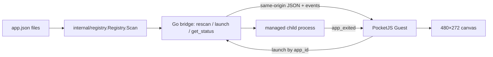

# CPR69: PocketJS feasibility prototype report

Status: PocketJS guest builds and renders through the official PocketJS browser host. This is a framework feasibility prototype, not a replacement of heya's SDL2 frontend; Registry/Launcher integration and target-device acceptance remain open.

## Implemented in this branch

- Branch: `pocketjs-prototype`, in isolated worktree `~/development/heya-pocketjs-prototype` based on the fetched `iamcheyan/heya` `origin/master` at `bca7c0510ac6c857b55c9532b9165dd332b8477c`.
- `pocketjs/heya-pocket-main.tsx`: PocketJS Solid guest with status row, six-app carousel, `Focusable` cards, one-column `FocusGrid`, D-pad/button handlers, `focus:` style variants, a native `spring()` call, quick menu with focus scope, favorite control and compact action footer.
- `pocketjs/src/sandbox.tsx` and `pocketjs/src/style.css`: responsive design-only Vite sandbox for visual exploration; explicitly separate from PocketJS runtime evidence.
- `pocketjs/tools/dump-apps/main.go`: scans heya's own `internal/registry` and emits JSON; `pocketjs/src/apps.generated.ts` is the generated fixture.
- `pocketjs/src/heya-registry.ts`: maps heya app metadata into the card model.
- `pocketjs/README.md`: setup and integration boundary.
- `docs/pocketjs-evaluation.md`: SDL2/PocketJS comparison, current framework limitations, recommendation and remaining acceptance work.

Core Go Launcher, Registry, System, model, scanner, metadata and SDL2 code are unchanged. The main checkout's existing modified `cmd/heya/main.go` and `internal/ui/ui.go` were left untouched.

## PocketJS runtime verification

PocketJS is a native component runtime, not a DOM/CSS framework. The guest uses PocketJS host components and style literals; CSS belongs only to the comparison sandbox. Built with PocketJS 0.15.0 and the official compiler:

```sh
~/.bun/bin/bun tools/wasm.ts
~/.bun/bin/bun tools/build.ts apps/heya-pocket/main.tsx --extra-chars="ステト世中你好文日本界繁語體국스어테트한"
PORT=8130 ~/.bun/bin/bun tools/dev/web/serve.ts
```

Observed build result: 27 compiled style records, 8 `.pak` entries, guest JS 188,230 bytes, `.pak` 306,176 bytes; no unknown-style warnings. The browser host loaded `heya-pocket-main`; the canvas was 480×272, reported 3.6 MB runtime memory, and visibly rendered the status row, carousel, selected card, caption and all four compact action controls. A screenshot was saved outside the repo under `~/.hermes/cache/scratch/heya-pocketjs-review/pocketjs-cjk2.png`. `npx tsc --noEmit` passes for the guest source.

The host chrome displays an emulator keyboard map. In that map, arrows are D-pad, X sends CROSS, A sends SQUARE, S sends TRIANGLE, Enter/Z sends CIRCLE. These are emulator controls, not heya's final controller map.

## Input verification

Held-key pixel hashes showed every control path changing the canvas: `ArrowRight` 589839760→410683622, `KeyX`→3916112886, `KeyS`→160249272, `KeyA`→2478779282, `Enter`→3471984398. Single-frame presses were dropped by the host's per-frame sampling, so the prototype uses held keys for control verification.

## Registry data and live synchronization

Status: Registry synchronization and the Go sidecar lifecycle IPC are verified against the PocketJS 0.15.0 browser host. The Guest loads Registry results through `/cmd rescan` at startup and from Quick Menu, then replaces the visible card list. The sidecar resolves IDs via `internal/registry.Registry.Scan()` and launches only matching manifests.



The browser host uses an optional `/heya/bridge/*` reverse proxy; the Guest uses PocketJS `net.fetch` for `/cmd` and `/events?since=N`. For phase 1 add/remove proof and phase 2 launch/exit proof, see [`pocketjs-registry-bridge.md`](pocketjs-registry-bridge.md) and [`pocketjs-ipc.md`](pocketjs-ipc.md).

Evidence: the dumper built in the ROCKNIX build image (Go 1.23.1), scanned `examples/apps` as `clock, hello` and scanned six CJK font-review apps. The Browser UI smoke checks live Registry IDs and canvas change on `alpha → alpha,beta → beta`. The IPC browser smoke invoked Guest `launch()` for a temporary `/usr/bin/true` application, observed `app_started`/`app_exited`, queried stopped status and rescanned the changing app directory. Protocol details and limitations are in [`pocketjs-ipc.md`](pocketjs-ipc.md); phase 1 screenshots remain under [`../pocketjs/screenshots/`](../pocketjs/screenshots/).

Risk / limit: Go IPC is a separate sidecar that reuses the Registry and owns a child process. `cmd/heya` and `internal/launcher` were deliberately unchanged; this proves the PocketJS ↔ sidecar JSON/lifecycle boundary, not in-process integration with the existing SDL Launcher. Browser proxy and `__heyaBridgeUrl` injection are local validation-host edits in the external PocketJS checkout. Event history is in-memory, limited to 256 entries, and resets on sidecar restart. No production network/auth surface is enabled; sidecar defaults to loopback.

The generated TypeScript fixture remains build-time fallback only; live application lists and actions use the runtime Go sidecar when configured.

## What the experiment says

- PocketJS browser host renders the Guest at 480×272 and exposes Solid focus components, focus scopes, style variants and motion. Phases 4 and 5 still determine controller and i18n completeness.
- Registry data and child-process lifecycle work through a separate Go JSON sidecar in the browser-host experiment. The existing SDL `cmd/heya` event loop and `internal/launcher.Launcher` are unchanged and do not consume this sidecar protocol.
- The target display is 720×480. The browser experiment and sidecar lifecycle do not establish the official PocketJS Linux native renderer, ARM64 frame time, RSS/CPU acceptability, or ROCKNIX deployment readiness.
- The official browser host serves the UI and routes same-origin requests to a Go sidecar. Its local PocketJS host modifications are not upstream PocketJS or shipping integration.

## Recommendation (current evidence)

Keep SDL2 for RG34XX while PocketJS remains a parallel experiment. The Registry and sidecar contracts work in the browser host, but there is no in-process Launcher integration and no Linux/ARM64/device proof. Re-evaluate after phases 3, 6, 7 and 8 provide direct runtime evidence. Final A/B/C/D recommendation belongs in `docs/cpr69-final-report.md` after all nine stages.

## Remaining before closing issue 69

- Verify the PocketJS Linux native host path from 0.15.0 source, including render and input without a browser.
- Complete controller, focus, menu, internationalization and font-load-failure checks with evidence.
- Measure PocketJS and SDL2 resource/frame behavior; then run an ARM64 target/container stability observation.
- Assess the sidecar boundary against the existing Launcher without changing core behavior and verify the minimal launch/return/rescan/status loop.
- Produce the nine-stage final report; close CPR69 only after every stage has an evidence-based disposition.

## Sources

- PocketJS package: https://www.npmjs.com/package/@pocketjs/framework (0.15.0)
- PocketJS docs: https://pocketjs.pocket.nexus/docs/overview/ , https://pocketjs.pocket.nexus/docs/platform-contracts/ , https://pocketjs.pocket.nexus/docs/animation/ , https://pocketjs.pocket.nexus/docs/input-focus/
- heya source: `../README.md`, `../docs/application-manifest-spec.md`, `../internal/model/model.go`, `../internal/launcher/launcher.go`, `../internal/registry/registry.go`, `../internal/system/system.go`