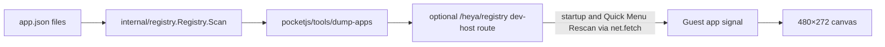

# CPR72 阶段1：Registry → PocketJS 同步

状态：已验证（PocketJS 0.15.0 官方浏览器/WASM host）。

## 数据流



- `dump-apps` 调用 heya 自己的 `Registry.Scan()`，将已校验、排序、非隐藏应用序列化为 JSON。entrypoint 取 `Entrypoint`，为空时回退 `Exec`。
- 浏览器原型的 dev-host route 每个 GET 都重新运行 scanner；`HEYA_REGISTRY_SCANNER` 可指向预编译程序，避免每次 `go run` 的编译成本。`HEYA_APPS` 和 `HEYA_ROOT` 配置扫描目标。
- PocketJS host 在 boot 前注入当前 origin 的 `__heyaRegistryUrl`。Guest 启动时拉取 Registry，也可从 Quick Menu 手动 Rescan；响应转换成卡片后替换 signal。fixture 仅用于桥接服务不可用时的初始显示。

## 实测

在 ROCKNIX build 容器（Go 1.23.1）编译 `dump-apps`。它扫描 `examples/apps` 输出 `clock`, `hello`；扫描 `examples/font-samples` 输出六个应用，包括中、日、韩和混排名称。通过临时 app 目录运行纯数据 smoke：初始 `alpha`，新增 `beta` 后 `alpha,beta`，删除 `alpha` 后 `beta`。

在 PocketJS 0.15.0 官方 browser/WASM host（480×272）运行 Playwright UI smoke。脚本等待每次 Guest 启动的 `/heya/registry` 响应，校验 HTTP 成功与 JSON ID 集合，同时保存 480×272 Canvas 截图并比较 framebuffer hash 和亮像素数。临时 app 目录状态为 `alpha`、`alpha,beta`、`beta`；三次响应 IDs 均与预期匹配，画布每次有变化，浏览器无 runtime errors。
- [初始 alpha](../pocketjs/screenshots/registry-ui-alpha.png)
- [新增 beta](../pocketjs/screenshots/registry-ui-alpha-beta.png)
- [删除 alpha](../pocketjs/screenshots/registry-ui-beta.png)

UI smoke 通过 Guest startup 依次运行三种目录状态；启动刷新和 Quick Menu Rescan 共用同一 fetch、JSON 映射及 card-signal 替换路径。截图记录 Canvas 输出，不作为 OCR 或逐字识别证据。

## 风险与边界

- `/heya/registry` 是给验证使用的 PocketJS dev-host 插件，不是 PocketJS 上游功能，也不是 heya production host。正式集成应由阶段2定义 IPC 协议并覆盖当前请求边界。
- 每次请求进程启动 scanner；预编译 scanner 可降低延迟，但阶段1没有收集延迟基准。
- HTTP 500 时 Guest 保留旧数据并更新错误文案。空 Registry 响应被拒绝，避免短暂显示空列表。
- Fixture 仍是初次启动的 fallback；实时替换条件来自 host 已注入 Registry URL 且 route 工作。
- 没有修改 heya Registry 或 Launcher 核心实现。

## 重现

```sh
# PocketJS checkout 中先构建 Guest：
cp /path/to/heya-pocketjs-prototype/pocketjs/heya-pocket-main.tsx apps/heya-pocket/main.tsx
cp /path/to/heya-pocketjs-prototype/pocketjs/src/apps.generated.ts apps/heya-pocket/apps.generated.ts
cp /path/to/heya-pocketjs-prototype/pocketjs/src/heya-registry.ts apps/heya-pocket/heya-registry.ts
bun tools/build.ts apps/heya-pocket/main.tsx --extra-chars="ステト世中你好文日本界繁語體국ス어테트한"

# 在 heya 仓库编译 dumper，然后运行 bridge UI smoke：
go build -o /tmp/dump-apps ./pocketjs/tools/dump-apps
POCKETJS_ROOT=/path/to/pocketjs-main CHROME_PATH=/path/to/chromium HEYA_REGISTRY_SCANNER=/tmp/dump-apps pocketjs/tools/dev-bridge/ui-smoke.sh
```
